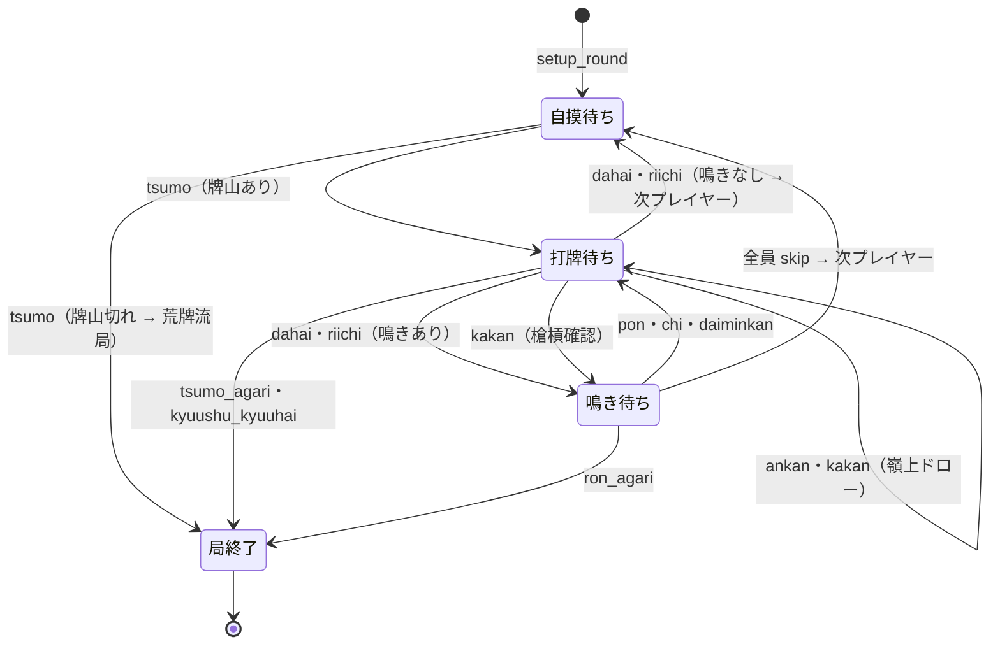
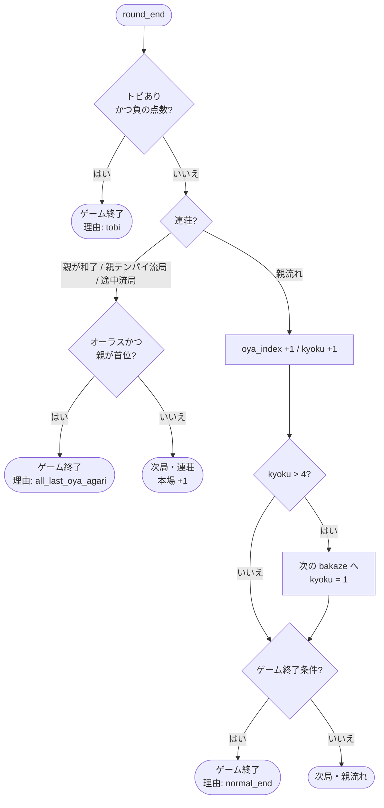
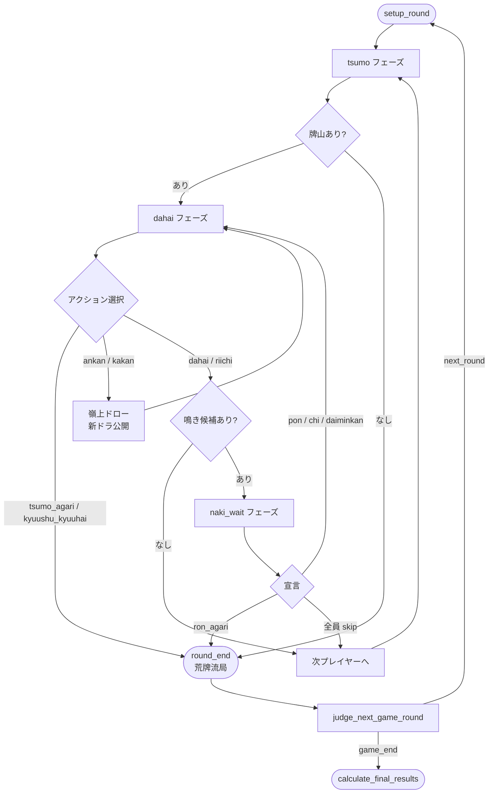

# 局ステートマシン

`riichi_engine` の局進行は 4 つのフェーズ（状態）を持つステートマシンとして実装されています。  
このドキュメントでは各フェーズの意味・遷移条件・アクション優先順位・特殊シーケンスを解説します。

---

## フェーズ一覧

| フェーズ | 意味 | 次に起こること |
|---|---|---|
| `:tsumo` | 自摸待ち。現在の手番プレイヤーが牌を引く前 | `:tsumo` アクションを受け取ると牌を引いて `:dahai` へ |
| `:dahai` | 打牌待ち。手番プレイヤーが牌を切る前 | 打牌・リーチ・カン・和了・九種を選択できる |
| `:naki_wait` | 鳴き待ち。打牌後に他プレイヤーが鳴き・ロンを宣言できる猶予 | 宣言を集めて解決後、打牌か局終了へ |
| `:round_end` | 局終了。和了・流局など | これ以上アクションは受け付けない |

現在のフェーズは `state.phase` で取得できます。

---

## 状態遷移図



---

## 各フェーズの詳細

### :tsumo フェーズ

**何をするか：** 手番プレイヤーが牌山から1枚引きます。

**受け付けるアクション：**

| アクション | 条件 | 次のフェーズ |
|---|---|---|
| `:tsumo` | 常に可 | 牌山に残りがあれば `:dahai`。残り 0 なら `:round_end`（荒牌流局） |

**注意：** `:tsumo` アクションは「引く」という操作そのものです。host app は自動的に送っても、ユーザーが「ツモ」ボタンを押してから送っても構いません。

```ruby
result = RiichiEngine::API.apply_round_action(
  state:  state,
  action: { type: :tsumo },
  rule:   rule
)
# state.phase => :dahai
```

---

### :dahai フェーズ

**何をするか：** 手番プレイヤー（`state.current_seat`）が打牌・リーチ・カン・和了のいずれかを選びます。

**受け付けるアクション：**

| アクション | 条件 | 次のフェーズ |
|---|---|---|
| `:dahai` | 手牌にある牌 | 鳴ける人がいれば `:naki_wait`、いなければ次プレイヤーの `:tsumo` |
| `:riichi` | 門前・テンパイになれる打牌・1000点以上 | `:dahai` と同じ遷移 |
| `:ankan` | 手牌に同種4枚・カン可能状態 | 嶺上牌を引いて `:dahai`（同じプレイヤーが続行） |
| `:kakan` | ポン済みの牌が手牌にある・カン可能状態 | 他プレイヤーが槍槓できれば `:naki_wait`、でなければ嶺上後 `:dahai` |
| `:tsumo_agari` | 手牌が和了形かつ役あり | `:round_end` |
| `:kyuushu_kyuuhai` | 第一ツモ・河が空・手牌に么九牌9種以上 | `:round_end` |

**選択肢を取得する：**

```ruby
actions = RiichiEngine::API.available_round_actions(
  state: state,
  seat:  state.current_seat,
  rule:  rule
)
# => [
#   { type: :dahai, tile: "1m" },
#   { type: :dahai, tile: "9p" },
#   { type: :riichi, choices: ["3z", "7m"] },  # リーチ可能な打牌候補
#   { type: :tsumo_agari },                     # 和了可能な場合
#   { type: :ankan, tile: "5m" },               # カン可能な場合
# ]
```

`choices` は複数の打牌候補がある場合の配列です。どれを選ぶかは host app 側で決定します。

---

### :naki_wait フェーズ

**何をするか：** 打牌されたあと、他のプレイヤーが「鳴く・ロンする・スキップする」を宣言します。  
全員がスキップするか、鳴き・ロンが確定するまでこのフェーズに留まります。

**受け付けるアクション：**

| アクション | 宣言できるプレイヤー | 条件 | 次のフェーズ |
|---|---|---|---|
| `:ron_agari` | 打牌プレイヤー以外で和了形になるプレイヤー | フリテンでない | `:round_end` |
| `:daiminkan` | 手牌に同種3枚のプレイヤー（左の人には関係なし） | カン可能状態 | `:dahai`（嶺上牌を引いてから） |
| `:pon` | 手牌に同種2枚のプレイヤー | リーチ中でない | `:dahai` |
| `:chi` | 打牌プレイヤーの左隣のみ | 数牌のみ・連番が手牌にある | `:dahai` |
| `:skip` | `pending_actions` にいる全員 | 常に可 | 全員スキップ時は次プレイヤーの `:tsumo` |

**各プレイヤーの選択肢を取得する：**

```ruby
# 鳴き待ち中、各プレイヤーが選べるアクションを確認
[0, 1, 2, 3].each do |seat|
  actions = RiichiEngine::API.available_round_actions(
    state: state,
    seat:  seat,
    rule:  rule
  )
  next if actions.empty?

  puts "seat #{seat}: #{actions.map { |a| a[:type] }.join(', ')}"
end
# 例: seat 1: ron_agari, skip
#     seat 2: pon, skip
#     seat 3: skip
```

---

#### アクションの優先順位

複数のプレイヤーが同時に宣言した場合、以下の優先順位で1つに絞ります。

| 優先度 | アクション | 備考 |
|---|---|---|
| 1（最高） | `:ron_agari` | ロンは最優先。ダブロン（2人同時ロン）はルール設定で許可する場合を除き、優先度の低い方はキャンセル |
| 2 | `:daiminkan` / `:pon` | 同優先度の場合、座席番号が小さい方が優先 |
| 3（最低） | `:chi` | 上家からしか鳴けないため実質競合しない |

この解決は `RiichiEngine::API.resolve_pending_action` が行います。

```ruby
# 複数プレイヤーが宣言した場合の競合解決
# state.pending_actions => { 1 => [{ type: :pon }], 2 => [{ type: :ron_agari }] }

resolved = RiichiEngine::API.resolve_pending_action(state.pending_actions)
# => { type: :ron_agari, seat: 2 }  # ロンが優先

RiichiEngine::API.apply_round_action(state: state, action: resolved, rule: rule)
```

**優先度違反はバリデーションでブロックされます：**

```ruby
# seat 1 がポンを宣言しようとしても、より優先度の高い seat 2 のロンがある場合は弾かれる
RiichiEngine::API.apply_round_action(
  state:  state,
  action: { type: :pon, seat: 1 },
  rule:   rule
)
# => RiichiEngine::API::InvalidActionError: higher priority action exists
```

**スキップの扱い：**

スキップは「全員がスキップした時点で」次へ進みます。
1人がスキップしても他の人がまだ宣言中であれば、`pending_actions` からその人の選択肢が消えるだけで `:naki_wait` は継続します。

```ruby
# seat 3 がスキップ → まだ seat 1, 2 が残っているなら naki_wait 継続
RiichiEngine::API.apply_round_action(
  state:  state,
  action: { type: :skip, seat: 3 },
  rule:   rule
)
# state.phase => :naki_wait（続行）

# seat 1, 2 もスキップ → 全員パスで次プレイヤーへ
# state.phase => :tsumo
```

---

### :round_end フェーズ

**何をするか：** 局が終了した状態です。追加アクションは一切受け付けません。

終了理由は `result.round_end_info.result_type` で確認できます。

| result_type | 意味 |
|---|---|
| `:tsumo_agari` | ツモ和了 |
| `:ron_agari` | ロン和了 |
| `:ryuukyoku` | 荒牌流局（牌山切れ） |
| `:kyuushu_kyuuhai` | 九種九牌 |
| `:suufon_renda` | 四風連打 |
| `:suucha_riichi` | 四家リーチ |
| `:sanchahou` | 三家和 |
| `:suukaikan` | 四槓散了 |

```ruby
result = RiichiEngine::API.apply_round_action(
  state:  state,
  action: { type: :tsumo_agari, seat: 0 },
  rule:   rule
)

if result.round_end?
  puts result.round_end_info[:result_type]  # => :tsumo_agari
end
```

---

## 特殊シーケンス

### 槓（カン）の流れ

槓にはアンカン・カカン・ダイミンカンの3種類があり、いずれも「嶺上牌を引いて `:dahai` フェーズに戻る」流れになります。ただし槓できる回数には上限があります（`kan_available?` で確認）。

```
:ankan / :kakan / :daiminkan
  → 嶺上牌をドロー（rinshan_flag = true）
  → 新しいドラ表示牌を公開
  → :dahai フェーズへ（同じプレイヤーが続行）
  → :tsumo_agari で嶺上開花が成立
```

```ruby
# アンカン
RiichiEngine::API.apply_round_action(
  state:  state,
  action: { type: :ankan, seat: 0, tile: "5m" },
  rule:   rule
)
# state.phase => :dahai（嶺上牌が追加されている）
# state.last_tsumo => 嶺上牌
```

### 槍槓（チャンカン）の流れ

カカンを宣言した際、他プレイヤーが同じ牌でロンできる（槍槓）場合は一時的に `:naki_wait` を経由します。

```
:kakan 宣言
  → 槍槓できるプレイヤーがいる → :naki_wait
      └ :ron_agari → :round_end（槍槓成立）
      └ 全員 :skip → 嶺上牌をドロー → :dahai
  → 誰も槍槓できない → 直接 :dahai へ
```

---

## 局終了後のゲームフロー

`round_end_info` を使って次局へ進むかゲームを終了するかを判定します。

```ruby
flow = RiichiEngine::API.judge_next_game_round(
  progress_snapshot: progress_snapshot,
  round_end_info:    result.round_end_info,
  rule:              rule
)
```

判定ロジックの概要：



| `flow.action` | 意味 |
|---|---|
| `:next_round` | 次局へ。`flow.next_bakaze`, `flow.next_kyoku`, `flow.next_honba`, `flow.next_oya_index` で次局情報を取得 |
| `:game_end` | ゲーム終了。`flow.reason` に理由が入る |

```ruby
case flow.action
when :next_round
  # 次局の snapshot を構築して setup_round へ
  next_snapshot = Mahjong::Snapshots::GameSetupSnapshot.new(
    bakaze:    flow.next_bakaze,
    kyoku:     flow.next_kyoku,
    honba:     flow.next_honba,
    kyoutaku:  new_kyoutaku,   # リーチ棒の引き継ぎは host app 側で計算
    oya_index: flow.next_oya_index,
    scores:    updated_scores
  )
  state = RiichiEngine::API.setup_round(game_snapshot: next_snapshot, rule: rule)

when :game_end
  final_results = RiichiEngine::API.calculate_final_results(
    final_result_snapshot: final_snapshot,
    rule: rule
  )
end
```

---

## 1局の全体フローまとめ


